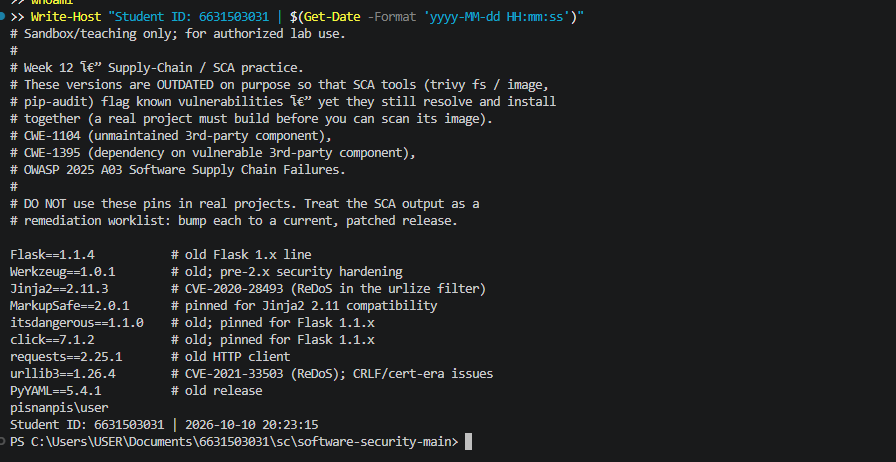
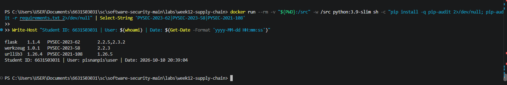
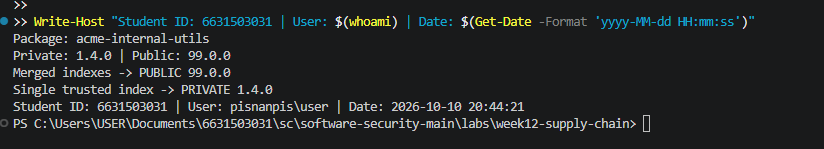
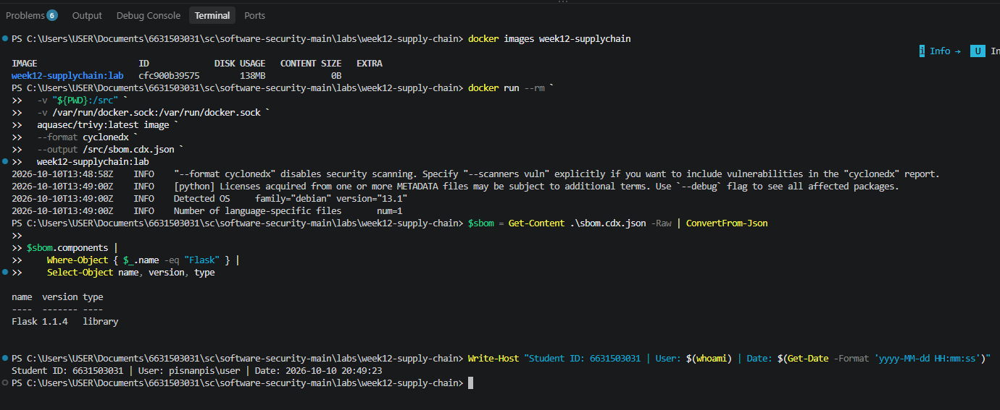
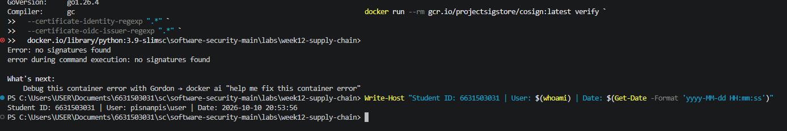
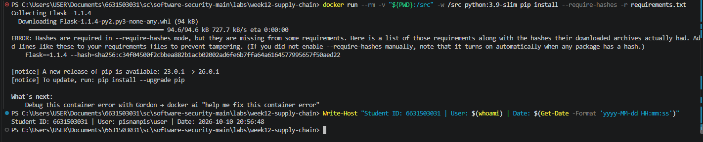

# Worksheet 12 — Software Supply-Chain Security (3 hrs)

> **Course:** Software Security (KOSEN69) · Week 12
> **Aligned:** OWASP 2025 — A03 Software Supply Chain Failures · A08 Software or Data Integrity Failures · **CWE:** CWE-1104, CWE-829, CWE-1357, CWE-1395
> **Signature game:** 📦 Dependency Confusion Heist
>
> **Ethics note:** This lab has **no live private/public registry to attack** — the dependency-confusion exercise is a controlled walkthrough (`dependency-confusion.md`) plus the interactive resolver simulation in Task 2, not a real package pull. **Never** plant or publish look-alike packages on the real PyPI or npm — that is an attack on every downstream user, and nothing in this lab requires it.

## Part 1 — Student Information

| Name | Student ID | Date | Group |
|------|-----------|------|-------|
|  Pirisa Kitichai  | 6631503031  | 10/10 |    |

## Part 2 — Lecture Questions

### 1. Dependency Confusion
Dependency confusion occurs when a package manager searches both private and public repositories. The public `acme-internal-utils==99.0.0` may be selected over private `1.4.0` because the resolver chooses the highest eligible version without prioritizing the private index.

### 2. Typosquatting
Attackers create malicious packages with names similar to legitimate ones, such as `reqeusts`. If installed, malicious setup scripts or build hooks may execute code during installation, before the application runs.

### 3. SBOM
An SBOM (CycloneDX/SPDX) lists software components and their versions. It helps identify vulnerable dependencies during incidents and complements SLSA provenance by showing what the software contains.

### 4. Sigstore Keyless Signing
Fulcio issues short-lived certificates linked to OIDC identities, while Rekor records signing events. This reduces the risk of stolen or hard-coded long-lived private keys (CWE-321).

### 5. SLSA Levels
SLSA Build Level 1 requires provenance, Level 2 requires authenticated provenance from a hosted build platform, and Level 3 adds stronger build isolation and tamper resistance. Signed artifacts, an SBOM, and a provenance gate improve security but do not automatically qualify for a specific SLSA level.


## Part 3 — Hands-on Lab (150 min)

**Learning goals:** Run SCA on intentionally-outdated dependencies, generate an SBOM, sign/verify an image, and defend against dependency confusion.

**Prerequisites:** Docker; the lab folder (`requirements.txt`, `Dockerfile`, `app.py`, `sca_scan.sh`, `sign.sh`). For signing: browser for the OIDC flow + registry push access.

**Environment setup**
```bash
cd labs/week12-supply-chain
bash sca_scan.sh                 # trivy fs + pip-audit on requirements.txt (+ optional image scan)
docker build -t week12-supplychain:lab .
bash sign.sh week12-supplychain:lab   # CycloneDX SBOM -> sbom.cdx.json, then cosign sign + verify
```

**What to submit per task:** the exact command(s) + output, a screenshot, and a 2–3 sentence remediation note mapping the finding to A03/A08 or the CWE.

### Task 0 — Onboarding (15 min)
Read `requirements.txt` and list the pinned packages with their versions. Note why they are intentionally outdated (each is deliberately an old release so SCA tools flag its known CVEs).
**Deliverable:** the package/version table + which OWASP/CWE this maps to.


### Task 0 — Onboarding

**Command Used:**
```powershell
Get-Content labs/week12-supply-chain/requirements.txt
```

**Dependency Inventory:**

| Package | Pinned Version |
|---|---|
| Flask | 1.1.4 |
| Werkzeug | 1.0.1 |
| Jinja2 | 2.11.3 |
| MarkupSafe | 2.0.1 |
| itsdangerous | 1.1.0 |
| click | 7.1.2 |
| requests | 2.25.1 |
| urllib3 | 1.26.4 |
| PyYAML | 5.4.1 |

**Explanation:**

These nine dependencies are intentionally pinned to outdated versions for security testing. Older dependencies may contain known vulnerabilities and increase software supply-chain risks.

**Security Mapping:**
- **OWASP A03:2025:** Software Supply Chain Failures
- **CWE-1104:** Use of Unmaintained Third Party Components
- **CWE-1395:** Dependency on Vulnerable Third-Party Components

**Remediation:**

Upgrade vulnerable packages to compatible patched versions and verify the updates using SCA tools such as Trivy and pip-audit.

**Evidence:**



### Task 1 — SCA scan: build the remediation worklist (35 min)
**Goal:** Flag the known-vulnerable dependencies — A03.
**Steps:**
1. `bash sca_scan.sh` — read the `trivy fs` table (CVE, installed vs. fixed version) and the `pip-audit` advisory IDs (GHSA-/PYSEC-).
2. Pick three findings; record CVE/advisory id, severity, and the fixed version.
**Deliverable:** the SCA output + a 3-row remediation table (package → current → fixed).

### Task 1 — SCA Scan

**Tool:** pip-audit (Docker)

**Result:** Found 33 known vulnerabilities across 6 packages.

| Package | Installed Version | Advisory ID | Fixed Version |
|---|---|---|---|
| Flask | 1.1.4 | PYSEC-2023-62 | 2.2.5 / 2.3.2 |
| Werkzeug | 1.0.1 | PYSEC-2023-58 | 2.2.3 |
| urllib3 | 1.26.4 | PYSEC-2021-108 | 1.26.5 |

**Remediation:** Upgrade vulnerable dependencies to compatible patched versions, update dependency pins, and rerun pip-audit to verify the fixes.

**OWASP/CWE:** OWASP A03:2025 — Software Supply Chain Failures; CWE-1395 — Dependency on Vulnerable Third-Party Components.


### Task 2 — Dependency Confusion Heist (35 min)
**Goal:** Watch the wrong package win — A03 / CWE-1357.

**Reality check:** this lab does **not** stand up a live private/public registry. `acme-internal-utils` is
a worked example, not an installable package — there is nothing to actually `pip install` here (the name
doesn't exist on real PyPI either, so don't expect that to work as a shortcut). Task 2 is a controlled
walkthrough of the resolver's own rule, using the simulation below, which computes the real
"highest version wins" logic live instead of just asserting the outcome.

```sim
resolver-confusion
```

**Steps:**
1. Read `dependency-confusion.md`'s "Dependency confusion (substitution)" section for the mechanism.
2. In the simulation, load the **"the attack"** preset (private `1.4.0`, public `99.0.0`, merged /
   `--extra-index-url` mode) and record which index the resolver picks and why.
3. Keep the same version numbers and switch to the **single-index** (`--index-url`) mode; record how the
   verdict changes — this is the resolver behavior Task 4's "single trusted index" defense relies on.
4. Try the **"win the race"** preset (private version numerically higher than public) and note why the
   sim's own explanation calls that "not a defense."

**Deliverable:** a screenshot of the simulation's verdict in both index modes (merged vs. single) for the
same version pair, plus one sentence on why an attacker defeats the "keep my internal version number high"
idea.


### Task 2 — Dependency Confusion Heist

**Package:** `acme-internal-utils`

| Resolver Mode | Private Version | Public Version | Selected Package |
|---|---|---|---|
| Merged indexes (`--extra-index-url`) | 1.4.0 | 99.0.0 | Public 99.0.0 |
| Single trusted index (`--index-url`) | 1.4.0 | 99.0.0 | Private 1.4.0 |

**Explanation:**

In merged-index mode, the resolver selects the higher public version (99.0.0), allowing dependency confusion. In single-index mode, it selects the trusted private version (1.4.0) because the public index is not queried.

**Why "win the race" is not a defense:**

Increasing the private package version is not a reliable defense because an attacker can publish an even higher public version.

**Best Defense:**

Use a single trusted package index to prevent the resolver from downloading same-named packages from untrusted public repositories.

**Security Mapping:**
- OWASP A03:2025 — Software Supply Chain Failures
- CWE-1357 — Reliance on Insufficiently Trustworthy Component
- CWE-829 — Inclusion of Functionality from Untrusted Control Sphere

**Evidence:**




### Task 3 — SBOM + Signing/Verification

**Goal:** Generate a Software Bill of Materials (SBOM) and verify container image integrity.

#### 1. Generate CycloneDX SBOM

**Command:**

```bash
docker run --rm -v "${PWD}:/src" -v /var/run/docker.sock:/var/run/docker.sock aquasec/trivy:latest image --format cyclonedx --output /src/sbom.cdx.json week12-supplychain:lab
```

**Actual Result:**

The SBOM was generated successfully as `sbom.cdx.json`.

| Component | Version | Type |
|---|---|---|
| Flask | 1.1.4 | library |

The SBOM provides an inventory of software components and their versions, supporting supply-chain visibility and vulnerability management.

**Evidence:**



#### 2. Cosign Signature Verification

**Tool:** Sigstore Cosign v3.1.3

**Status:** Not completed.

The lab image was built locally, but keyless signing and successful verification of a signed image have not yet been performed. A registry-hosted image and OIDC authentication are required for the planned keyless signing workflow.

#### 3. Negative Test — Unsigned Image

**Command:**

```bash
cosign verify --certificate-identity-regexp ".*" --certificate-oidc-issuer-regexp ".*" docker.io/library/python:3.9-slim
```

**Actual Output:**

```text
Error: no signatures found
error during command execution: no signatures found
```

**Result: PASS (Expected Failure)**

Cosign rejected the unsigned image because no signature was found. This demonstrates that signature verification can reject an unsigned artifact before deployment.

**Evidence:**



#### Conclusion

The CycloneDX SBOM was successfully generated and Flask 1.1.4 was identified. The negative verification test also passed by rejecting an unsigned image.

However, successful verification of a signed image remains incomplete. Therefore, the full signing and verification workflow has not yet been demonstrated.

**Security Mapping:**
- OWASP A08:2025 — Software or Data Integrity Failures
- CWE-829 — Inclusion of Functionality from Untrusted Control Sphere


### Task 4 — Defend / fix it (35 min)
**Goal:** Stop dependency confusion and lock integrity — defenses from `dependency-confusion.md` + `sign.sh`.
**Steps:**
1. **Pin + hashes:** run `pip install --require-hashes -r requirements.txt` against this lab's own
   `requirements.txt` (it has no hashes yet) and record pip's refusal — `ERROR: Hashes are required in
   --require-hashes mode...` plus the `--hash=sha256:…` line pip prints for you. That refusal is the same
   mechanism that would block a real confusion substitution: once hashes are required, a package that
   doesn't match — from *either* index — cannot install silently.
2. **Single trusted index:** use one `--index-url` instead of `--extra-index-url`; explain why the resolver stops shopping around (tie this back to Task 2's single-index verdict).
3. **Namespace scoping:** describe reserving/namespacing the internal package name.
4. **Provenance gate:** state how the `cosign verify` from `sign.sh` becomes a gate before a simulated deploy.
**Deliverable:** the `--require-hashes` refusal output (step 1) + the simulation's before/after verdict for merged vs. single index (from Task 2) + the one defense you found most effective and why.


### Task 4 — Defend / Fix It

#### 1. Pin Dependencies with Hashes

**Command:**

`pip install --require-hashes -r requirements.txt`

**Actual Result:**

`ERROR: Hashes are required in --require-hashes mode.`

**Explanation:**

The installation was rejected because `requirements.txt` does not contain package hashes. Requiring verified hashes prevents packages with unexpected contents from being installed, helping defend against dependency substitution.

**Evidence:**




## Part 4 — Reflection

### 1. Security Mapping

| Finding | Tool | OWASP 2025 | CWE | Fix |
|---|---|---|---|---|
| Vulnerable dependencies (Flask, Werkzeug, urllib3) | `sca_scan.sh` / `pip-audit` | A03 — Software Supply Chain Failures | CWE-1395 | Upgrade to patched versions and rescan |
| Dependency confusion | Resolver simulation | A03 — Software Supply Chain Failures | CWE-1357, CWE-829 | Use a single trusted package index and verified hashes |
| Missing dependency hashes | `pip install --require-hashes` | A03 — Software Supply Chain Failures | CWE-829 | Pin versions and verify package hashes |
| Unsigned container image | `sign.sh` / `cosign verify` | A08 — Software or Data Integrity Failures | CWE-829 | Sign artifacts and enforce signature verification before deployment |

### 2. Real Breach — XZ Utils Backdoor (CVE-2024-3094)

The XZ Utils backdoor (CVE-2024-3094) was a software supply-chain attack in which malicious code was introduced into upstream XZ Utils release packages, potentially compromising systems using affected versions.

**OWASP:** A03 — Software Supply Chain Failures and A08 — Software or Data Integrity Failures.

**CWE:** CWE-829 — Inclusion of Functionality from Untrusted Control Sphere.

An SBOM could identify affected XZ Utils versions, helping incident response, but it would not detect malicious code by itself. Signing and provenance verification could confirm the origin and integrity of an artifact, but they might still accept a malicious release signed by a trusted upstream maintainer. Additional source review, reproducible builds, and independent security checks are needed.

### 3. Best Mitigation + SLSA Self-Assessment

Our lab generated a CycloneDX SBOM, identified vulnerable dependencies, demonstrated dependency confusion, and verified that Cosign rejected an unsigned image. However, we have not completed keyless signing or authenticated build provenance, so we cannot claim SLSA Build Level 1 or higher based on the current evidence. The most effective mitigation for our team would be using a single trusted dependency index with pinned versions and verified hashes, because it directly reduces the risk of dependency substitution and unauthorized package installation.

## Grading rubric (100)

| Criterion | Weight |
|-----------|--------|
| Lecture questions (Part 2) | 20 |
| Exploitation + evidence (Tasks 1–3: SCA findings, confusion proof, SBOM/verify) | 40 |
| Defense (Task 4: pinning/hashes, single index, scoping, provenance gate) | 25 |
| Reflection (Part 4: mapping, XZ breach, SLSA self-assessment) | 15 |
| **Total** | **100** |

---

## Evidence & Integrity (required)

- **Identity proof:** every screenshot/diagram must show a terminal running `printf '%s | %s | ' "$(whoami)" '<YOUR-STUDENT-ID>'; date '+%F %T %Z'` **in the
  same image as the evidence**. When the evidence is a browser page, a DevTools panel or a
  rendered response, put that terminal **beside the browser and capture the whole screen** — a
  cropped window carries nothing that identifies you, and the lab's own output is
  byte-identical for the whole cohort *by design*, so the stamp is the only thing that makes
  the shot yours. Generic or borrowed evidence is not accepted.
- **Personalized flag (if this lab issues one):** ____________________
  *Flags are unique per student — submitting another student's flag is a violation. How to submit: **learn.zcr.ai/submit** (full guide: `SUBMISSION.md` in the repo root).*
- **Explain in your own words** *(graded on your reasoning, not copied text):*
  1. What did you do, and **why did the vulnerability work**?
  2. **Why does your fix actually stop it** — and what could still break it?

---

## 🤖 Audit the AI (required)

### 1. AI Prompt

How can I securely prevent dependency confusion in a Python project where an internal package `acme-internal-utils==1.4.0` and a public package `acme-internal-utils==99.0.0` are both visible through `--extra-index-url`? Provide the exact fix and a safe verification method.

### 2. AI Answer

[Paste the AI's full response to the prompt above here.]

### 3. Identify the Risk

Review the AI's answer for any incomplete or unsafe recommendation.

**Exact quote from the AI:**
> [Insert an exact sentence from the AI's response.]

**Critique:**

Version pinning alone does not prevent dependency confusion if the pinned package can still be obtained from an untrusted index. A secure solution must also control the package source and verify integrity.

### 4. Corrected and Verified Solution

**Secure approach:**
- Use `--index-url` with a single trusted package index.
- Avoid `--extra-index-url` for internal packages.
- Pin approved dependency versions and verify trusted hashes using `--require-hashes`.

**Actual Lab Verification:**

| Test | Observed Result |
|---|---|
| Merged-index scenario | Public `99.0.0` selected in the controlled demonstration |
| Single-index scenario | Private `1.4.0` selected in the controlled demonstration |
| `pip install --require-hashes -r requirements.txt` | Installation rejected because hashes were missing |

**Evidence:**


### 5. Conclusion

The AI's recommendation must be checked against actual package resolution and integrity controls. Our lab demonstrated why using a trusted index and requiring verified hashes is safer than relying on package version numbers alone.

**AI Use Disclosure:** AI was used to help explain dependency confusion and review security controls. The lab results were checked separately.

> Disclose your AI use in the Part 1 table. This task counts toward your **Defense + Reflection** score.

---

## 🧠 Comprehension & Prompt (required)


## Comprehension & Prompt (Required)

### A. Explain in Plain English (EiPE)

The project may search both private and public package repositories when installing dependencies. If an attacker publishes a package with the same name but a higher version, the installer may select the attacker's package and introduce malicious code into the project.

### B. Prompt Problem

**Finding:** Dependency Confusion (CWE-1357)

**Final AI Prompt:**

"Fix dependency confusion in a Python project where the private package `acme-internal-utils==1.4.0` competes with a public package `acme-internal-utils==99.0.0`. Provide a secure pip configuration using one trusted index instead of `--extra-index-url`. Include exact version pinning, trusted SHA-256 hashes, and a safe verification procedure without installing malicious packages. Explain why higher version numbers alone are not a defense."

**Secure Fix:**

Use a single trusted package index (`--index-url`) and require verified dependency hashes with `--require-hashes`. Do not merge private and public indexes for internal packages.

**Verification Results:**

| Test | Observed Result |
|---|---|
| Merged indexes | Public version `99.0.0` selected in the controlled demonstration |
| Single trusted index | Private version `1.4.0` selected in the controlled demonstration |
| `pip install --require-hashes -r requirements.txt` | Installation rejected because required hashes were missing |

**Does the attack still work?**

Under the single-trusted-index scenario, the public package is excluded from consideration, preventing the demonstrated dependency-confusion substitution. The hash-enforcement test also rejected installation without verified hashes.

**Limitation:** This lab used a controlled demonstration rather than a live registry. The hash test confirmed rejection of missing hashes, not a successful installation with verified hashes.

**Evidence:**


