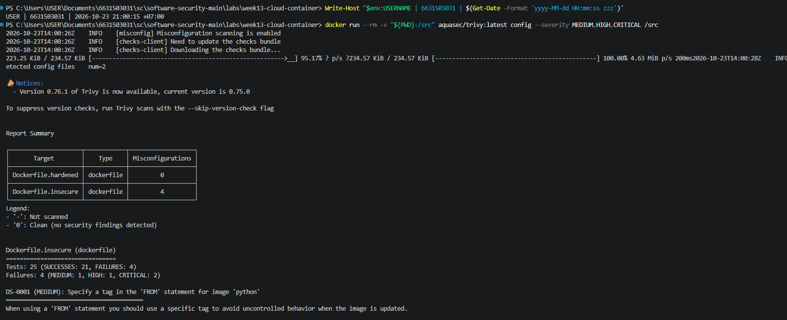
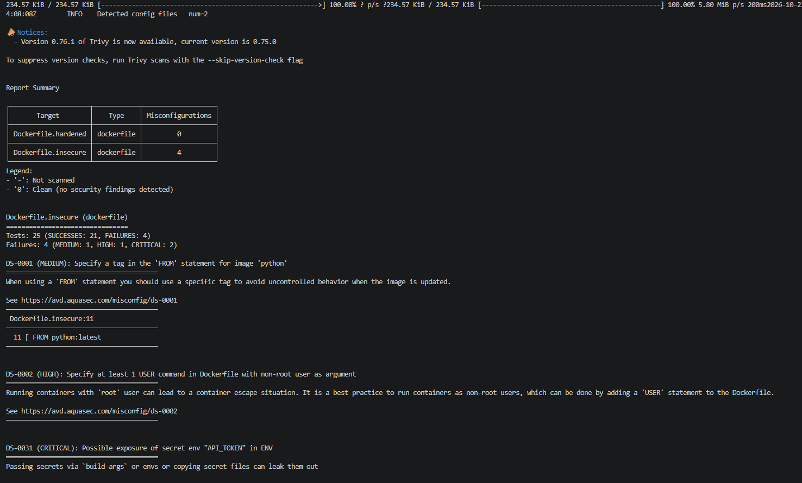
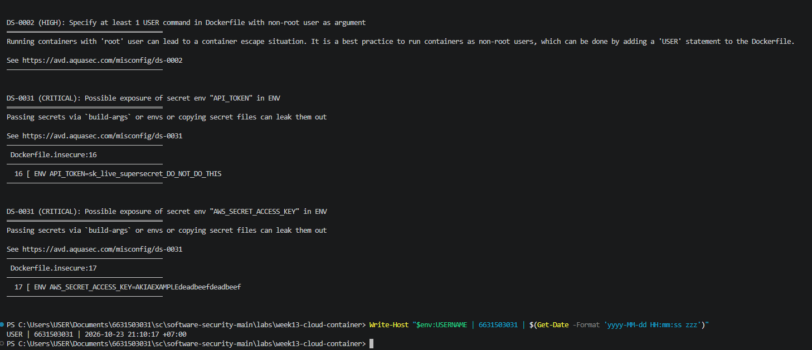
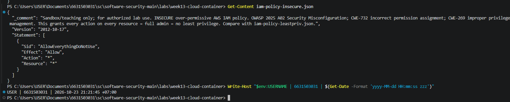
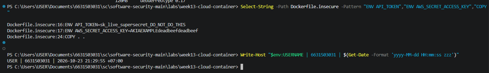
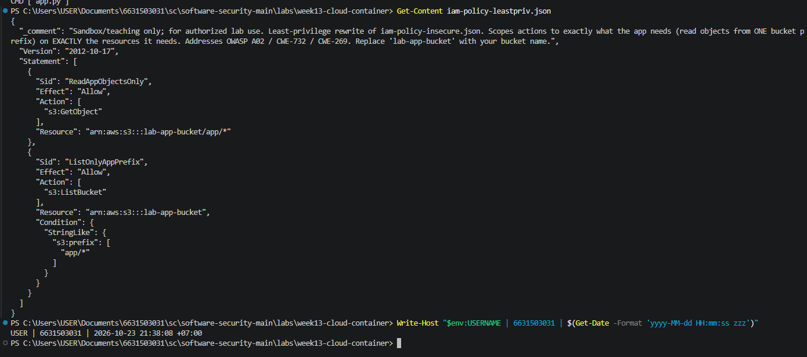
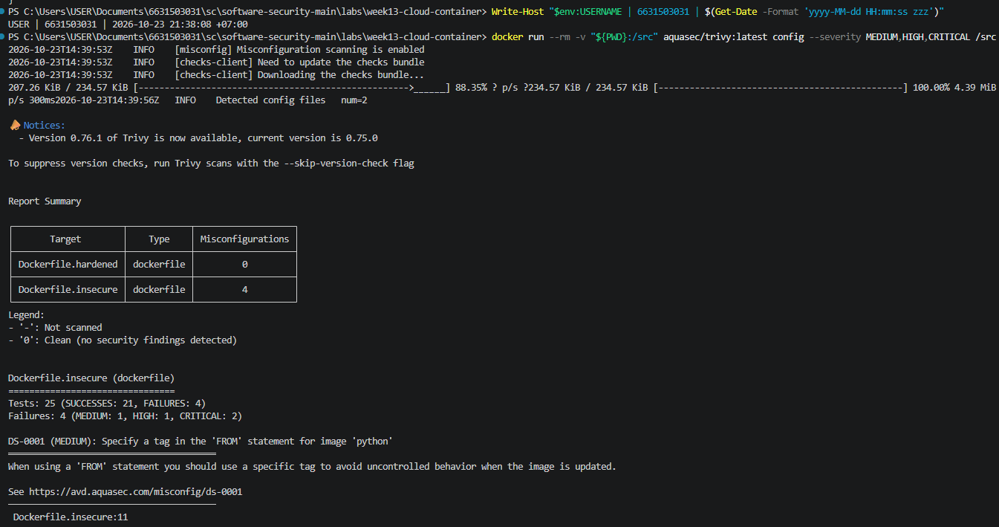
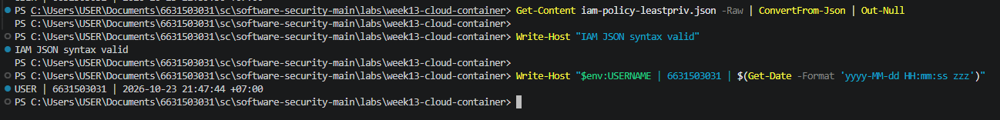

# Worksheet 13 — Cloud & Container Security (4 hrs)

> **Course:** Software Security (KOSEN69) · Week 13
> **Aligned to:** OWASP 2025 **A02 Security Misconfiguration** · **CWE-732** (incorrect permission assignment), **CWE-16** (configuration), plus CWE-798, CWE-250, CWE-538, CWE-269, CWE-1104
> **Signature game:** 🔍 *Misconfig Hunt* (CloudGoat-style) — each misconfig you find **and** fix = a flag.

> ⚠️ **Ethics note:** All artifacts here are deliberately broken for teaching and are marked *"Sandbox/teaching only; for authorized lab use."* Scan, exploit, and harden **only** these lab files (or systems you own / are authorized to test). Never point Trivy or these techniques at third-party cloud accounts or images without written permission.

---

## Part 1 — Student Information

| Name | Student ID | Date | Group |
|------|-----------|------|-------|
| Pirisa Kitichai | 6631503031 | 23/10 | Three Musketeers |

---

## Part 2 — Lecture Questions

Answer in your own words (2–4 sentences each).

### 1. Shared-Responsibility Model

The cloud provider is responsible for securing the cloud infrastructure, while users are responsible for securing their applications and data. For example, AWS protects the physical servers running S3, while we must configure S3 bucket permissions to prevent unauthorized access.

### 2. Least Privilege — CWE-732 vs. CWE-269

Using `"Action": "*"` and `"Resource": "*"` grants unnecessary permissions to all supported AWS resources. CWE-732 refers to incorrectly assigned resource permissions, while CWE-269 refers to improper management of user or application privileges.

### 3. Hardcoded Secrets — CWE-798 / CWE-200

Attackers with access to the Docker image can recover embedded secrets using `docker history --no-trunc` or `docker image inspect`. CWE-798 refers to hardcoded credentials, while CWE-200 refers to the exposure of sensitive information.

### 4. Unpinned Base Image — CWE-1104 / CWE-16

Using `python:latest` is risky because the image may change between builds, potentially introducing vulnerabilities or compatibility problems. Pinning the image using an `@sha256:` digest ensures that builds use the same image content until the digest is intentionally updated.

### 5. Distroless Base Image

A distroless image removes unnecessary tools such as shells and package managers that are available in typical Python images. This reduces the attack surface because attackers have fewer tools available to execute commands or perform further attacks after compromising the application.

---

## Part 3 — Hands-on Lab (180 min)

**Learning goals:** find cloud/container misconfigurations with Trivy, map each to a CWE, and rebuild the IAM policy + Dockerfile to least privilege / hardened so the findings drop.

**Prerequisites:** Docker installed and running; the `week13-cloud-container/` lab folder; internet access to pull `aquasec/trivy:latest`.

### Environment setup (real commands)

```bash
cd labs/week13-cloud-container

# Option A — the provided wrapper (trivy config over the Dockerfiles; IAM JSON is reviewed manually, see Task 2):
bash scan.sh

# Option B — run Trivy directly (MEDIUM is in the filter on purpose: one of the
# three rules Task 1 asks you to cite is rated MEDIUM, and HIGH,CRITICAL hides it):
docker run --rm -v "$PWD:/src" aquasec/trivy:latest config --severity MEDIUM,HIGH,CRITICAL /src

# (Optional) build + CVE-scan the hardened image:
docker build -f Dockerfile.hardened -t week13-hardened:lab .
docker run --rm -v /var/run/docker.sock:/var/run/docker.sock aquasec/trivy:latest image --severity HIGH,CRITICAL week13-hardened:lab
```

**What to submit per task:** the command(s) you ran + the relevant output (finding count or the specific finding line), a screenshot of the Trivy/terminal result, and a 2–3 sentence mitigation explaining *why* the fix reduces risk (cite the CWE).


### Tasks

- **Task 0 — Onboarding (15 min).** Confirm Docker works (`docker version`), run `bash scan.sh`, and record the **baseline finding count** against `Dockerfile.insecure` (Trivy's `config` scanner does not parse standalone IAM policy JSON, so `iam-policy-insecure.json` is reviewed manually instead — see Task 2). **Deliverable:** screenshot of the baseline scan.

### Task 0 — Onboarding

**Commands Executed:**

```powershell
docker version
docker run --rm -v "${PWD}:/src" aquasec/trivy:latest config --severity MEDIUM,HIGH,CRITICAL /src
```

**Baseline Scan Results:**

- Dockerfile.insecure: **4 findings**
- Dockerfile.hardened: **0 findings**
- Severity: 1 MEDIUM, 1 HIGH, 2 CRITICAL

**Explanation:**

I used Trivy to scan the Dockerfiles for security misconfigurations. The scan detected 4 findings in `Dockerfile.insecure`, while `Dockerfile.hardened` had no findings. The insecure Dockerfile will be reviewed and compared with the hardened version in the following tasks.

**Evidence:**



- **Task 1 — Misconfig Hunt: container image (40 min).** *Goal:* find every defect in `Dockerfile.insecure`. *Steps:* read each `# DEFECT:` comment, then locate the matching Trivy finding where one exists — only 3 of the 6 (unpinned `:latest`, runs as root, secrets in `ENV`) map to a Trivy config rule (`DS-0001`, `DS-0002`, `DS-0031`); `COPY . .`, `chmod -R 777`, and unpinned `pip install` are instruction-level RUN/COPY semantics Trivy's Dockerfile scanner doesn't check, so identify those 3 by code review instead. Build a table: defect → CWE → Trivy rule/severity (write "manual review — no Trivy rule" where none exists). *Deliverable:* completed table (6 rows) using the IDs from `harden.md`.

### Task 1 — Misconfig Hunt: Container Image

**Objective:** Identify six security defects in `Dockerfile.insecure` and map them to their CWE classifications and Trivy findings.

**Commands Executed:**

```powershell
Get-Content Dockerfile.insecure
docker run --rm -v "${PWD}:/src" aquasec/trivy:latest config --severity MEDIUM,HIGH,CRITICAL /src
```

**Security Findings:**

| Defect | CWE | Trivy Rule / Severity |
|---|---|---|
| Unpinned base image (`python:latest`) | CWE-1104, CWE-16 | DS-0001 / MEDIUM |
| Container runs as root (no `USER` directive) | CWE-250 | DS-0002 / HIGH |
| Hardcoded secrets in `ENV` (`API_TOKEN`, `AWS_SECRET_ACCESS_KEY`) | CWE-798, CWE-200 | DS-0031 / CRITICAL (2 findings) |
| Copies entire build context (`COPY . .`) | CWE-538 | Manual review — no Trivy rule |
| World-writable permissions (`chmod -R 777 /app`) | CWE-732 | Manual review — no Trivy rule |
| Unpinned dependencies (`pip install -r requirements.txt`) | CWE-1104 | Manual review — no Trivy rule |

**Scan Results:**

- Dockerfile.insecure: 4 findings
- Dockerfile.hardened: 0 findings
- Total checks: 25
- Passed: 21
- Failed: 4
- Severity: 1 MEDIUM, 1 HIGH, 2 CRITICAL

**Mitigation:**

The insecure Dockerfile uses an unpinned base image, runs as root, and exposes sensitive credentials through environment variables. It also copies unnecessary files, assigns overly permissive permissions, and installs dependencies without controlled versions. These weaknesses can increase the risk of credential exposure, unauthorized modification, and container compromise. Pinning image and dependency versions, removing embedded secrets, using a non-root user, restricting file permissions, and copying only necessary application files reduce these risks.

**Evidence:**

**Evidence:**





- **Task 2 — Misconfig Hunt: IAM (30 min).** *Goal:* document why `iam-policy-insecure.json` is full-admin. *Steps:* identify the `Action:*` / `Resource:*` / no-`Condition` problems; map to CWE-269 / CWE-732. *Deliverable:* 3-row table + one sentence on the blast radius if these creds leak.

### Task 2 — Misconfig Hunt: IAM

**Objective:** Identify three security misconfigurations in `iam-policy-insecure.json` and explain their risks.

**Command Executed:**

```powershell
Get-Content iam-policy-insecure.json
```

**IAM Security Findings:**

| Misconfiguration | CWE | Security Risk |
|---|---|---|
| `"Action": "*"` | CWE-269 | Grants permission to perform all AWS actions instead of only the required operations. |
| `"Resource": "*"` | CWE-732 | Allows access to all supported AWS resources without restricting permissions to specific resources. |
| Missing `"Condition"` | CWE-732 | Provides no additional restrictions on when or how permissions can be used. |

**Blast Radius:**

If these IAM credentials are compromised, an attacker could potentially access, modify, or delete resources across the AWS account because the policy grants unrestricted permissions.

**Mitigation:**

Apply the principle of least privilege by allowing only necessary actions, restricting access to specific S3 resources, and adding appropriate conditions to limit permissions.

**Evidence:**



- **Task 3 — Secrets & storage (25 min).** *Goal:* show secrets must not live in the image. *Steps:* explain how `ENV API_TOKEN` / `AWS_SECRET_ACCESS_KEY` are exposed via `docker history`; propose where they belong instead (secrets manager / mounted secret / orchestrator secret per `harden.md`). *Deliverable:* 2–3 sentence remediation + the `.dockerignore` entries you would add to stop `COPY . .` leaking `.git`/`.env` (CWE-538).

### Task 3 — Secrets & Storage

**Objective:** Identify exposed secrets in the Dockerfile and explain how to prevent sensitive information from being included in container images.

**Command Executed:**

```powershell
Get-Content Dockerfile.insecure
```

**Findings:**

The insecure Dockerfile contains two hardcoded secrets:

- `API_TOKEN` (Line 16)
- `AWS_SECRET_ACCESS_KEY` (Line 17)

These secrets are stored in `ENV` instructions and may be exposed through Docker image metadata or history.

**Remediation:**

Hardcoded secrets should be removed from the Dockerfile because they can be recovered from the distributed image using commands such as `docker history --no-trunc` and `docker image inspect`. Instead, secrets should be provided securely at runtime through a secrets manager, mounted secret files, or an orchestrator's secret mechanism. This reduces the risk of credential exposure (CWE-798 and CWE-200).

**Recommended `.dockerignore` entries:**

```gitignore
.git
.env
.env.*
*.pem
*.key
node_modules/
__pycache__/
```

The `.dockerignore` file prevents sensitive files and unnecessary directories from being copied into the Docker build context, reducing the risk of information exposure (CWE-538).

**Evidence:**



- **Task 4 — Hardened-Dockerfile + least-priv-IAM defense (50 min).** *Goal:* prove the "after" is clean. *Steps:* (a) re-run `bash scan.sh` (or `trivy config`) against `Dockerfile.hardened` and capture the **reduced** finding count (Trivy's config scanner does not parse standalone IAM JSON, so confirm the IAM fix manually per Task 2 by diffing `iam-policy-leastpriv.json` against the insecure policy); (b) for the Dockerfile, point to the fix for each Task-1 defect (digest pin, multi-stage venv, distroless runtime, `USER 65532:65532`, no secrets in `ENV`, copy only `app.py`); (c) for IAM, confirm the rewrite scopes `s3:GetObject` to `arn:aws:s3:::lab-app-bucket/app/*` and adds the `s3:prefix` `Condition`; (d) list the extra runtime flags from `harden.md` (`--read-only`, `--cap-drop ALL`, `--security-opt no-new-privileges`). *Deliverable:* before/after finding counts, the defect→fix mapping, and the diffed policy/Dockerfile with one sentence per fix.

### Task 4 — Hardened Dockerfile + Least-Privilege IAM Defense

**Objective:** Verify that the hardened Dockerfile reduces security misconfigurations and that the IAM policy follows the principle of least privilege.

**Commands Executed:**

```powershell
Get-Content Dockerfile.hardened
Get-Content iam-policy-leastpriv.json
docker run --rm -v "${PWD}:/src" aquasec/trivy:latest config --severity MEDIUM,HIGH,CRITICAL /src
```

**Before and After Scan Results:**

| Target | Misconfigurations | Status |
|---|---:|---|
| Dockerfile.insecure | 4 | Insecure |
| Dockerfile.hardened | 0 | No Trivy config findings |

**Defect-to-Fix Mapping:**

| Defect | Security Fix | CWE |
|---|---|---|
| Unpinned `python:latest` | Pin base images using SHA-256 digests | CWE-1104 |
| Running as root | Set `USER 65532:65532` | CWE-250 |
| Hardcoded secrets in `ENV` | Remove embedded credentials and inject secrets securely at runtime | CWE-798 |
| `COPY . .` | Copy only necessary files such as `app.py` | CWE-538 |
| `chmod -R 777` | Remove world-writable permissions | CWE-732 |
| Uncontrolled dependency installation | Use a multi-stage build, virtual environment, and controlled dependencies | CWE-1104 |

**IAM Policy Improvements:**

| Before | After |
|---|---|
| `"Action": "*"` | `s3:GetObject` and `s3:ListBucket` |
| `"Resource": "*"` | Restrict access to `lab-app-bucket` and `app/*` |
| No `Condition` | Apply `s3:prefix` condition to `s3:ListBucket` |

The revised IAM policy limits access to the required S3 bucket and application prefix, reducing excessive permissions (CWE-269 and CWE-732).

**Additional Runtime Hardening:**

- `--read-only`: Prevents modification of the container's root filesystem.
- `--cap-drop ALL`: Removes unnecessary Linux capabilities.
- `--security-opt no-new-privileges`: Prevents processes from gaining additional privileges.

**Verification and Conclusion:**

Trivy detected four misconfigurations in the insecure Dockerfile and zero in the hardened Dockerfile. The hardened version uses pinned base images, a distroless runtime, non-root execution, and no embedded secrets. The IAM policy was reviewed manually because the standalone IAM JSON is not scanned by Trivy.

**Evidence:**





 
- **Task 5 — Flag tally (20 min).** *Goal:* score the hunt. *Steps:* one flag per misconfig found **and** fixed (6 container + 3 IAM = 9). *Deliverable:* flag count + the single biggest-risk misconfig and why.

### Task 5 — Flag Tally

**Objective:** Summarize the security misconfigurations identified and fixed during the lab.

**Flag Summary:**

| Category | Misconfigurations Found and Fixed | Flags |
|---|---|---|
| Container Security | 6 | 6 |
| IAM Security | 3 | 3 |
| **Total** | **9** | **9/9** |

**Biggest-Risk Misconfiguration:**

The most dangerous misconfiguration was the IAM policy using `"Action": "*"` and `"Resource": "*"`, which granted excessive permissions across AWS resources.

If these credentials were compromised, an attacker could potentially access, modify, or delete sensitive cloud resources. Applying the principle of least privilege reduces the impact by restricting access to specific S3 actions, resources, and prefixes (CWE-269 and CWE-732).

**Verification:**

The insecure Dockerfile had 4 Trivy findings, while the hardened Dockerfile had 0. The six container defects and three IAM misconfigurations were reviewed against their hardened configurations.

**Final Flag Count: 9/9 (Lab Misconfiguration Hunt)**

**Evidence:**


---

## Part 4 — Reflection

### 1. Security Mapping

| Finding / Artifact | CWE | OWASP 2025 | Fix Applied |
|---|---|---|---|
| `Dockerfile.insecure` — `FROM python:latest` | CWE-1104, CWE-16 | A02: Security Misconfiguration | Pinned the base image using a SHA-256 digest to ensure reproducible builds. |
| `Dockerfile.insecure` — `ENV API_TOKEN=...` | CWE-798, CWE-200 | A02: Security Misconfiguration | Removed hardcoded secrets and recommended secure runtime secret injection. |
| `iam-policy-insecure.json` — `"Action": "*"` and `"Resource": "*"` | CWE-269, CWE-732 | A02: Security Misconfiguration | Restricted permissions to `s3:GetObject` and `s3:ListBucket` for the required bucket and application prefix. |

### 2. Real Incident — Capital One Data Breach (2019)

In 2019, Capital One experienced a data breach involving a server-side request forgery (SSRF) vulnerability and access to cloud credentials associated with an AWS role. The attacker used the obtained permissions to access sensitive data stored in S3.

A key lesson from this incident is the importance of least-privilege IAM permissions. Restricting access to only the required S3 actions and resources, as demonstrated in this lab, could have reduced the potential impact of compromised credentials. However, least privilege alone would not necessarily have prevented the initial SSRF attack.

### 3. Best Mitigation — Least-Privilege IAM vs. Distroless and Non-Root

I believe least-privilege IAM provides the greatest risk reduction for the effort required. Restricting IAM actions and resources can significantly reduce the damage caused by compromised cloud credentials.

Distroless images and non-root execution are also important because they reduce the container attack surface and unnecessary privileges. However, least-privilege IAM directly limits access to sensitive cloud resources, making it my preferred first control for this lab.
---

## Grading rubric (100)

| Component | Points | What earns full marks |
|-----------|:------:|-----------------------|
| Part 2 — Lecture questions | 20 | All 5 answered correctly with CWE/A02 reasoning |
| Part 3 — Tasks + evidence | 40 | Tasks 0–5 complete; commands, outputs, and screenshots present |
| Defense (Task 4 hardening) | 25 | Hardened Dockerfile + least-priv IAM shown to reduce findings; per-fix justification |
| Part 4 — Reflection | 15 | Accurate mapping, relevant incident, well-argued best mitigation |

---

## Evidence & Integrity (required)

- **Identity proof:** every screenshot/diagram must show a terminal running `printf '%s | %s | ' "$(whoami)" '<YOUR-STUDENT-ID>'; date '+%F %T %Z'` **in the
  same image as the evidence**. When the evidence is a browser page, a DevTools panel or a
  rendered response, put that terminal **beside the browser and capture the whole screen** — a
  cropped window carries nothing that identifies you, and the lab's own output is
  byte-identical for the whole cohort *by design*, so the stamp is the only thing that makes
  the shot yours. Generic or borrowed evidence is not accepted.
- **Personalized flag (if this lab issues one):** ____________________
  *Flags are unique per student — submitting another student's flag is a violation. How to submit: **learn.zcr.ai/submit** (full guide: `SUBMISSION.md` in the repo root).*
- **Explain in your own words** *(graded on your reasoning, not copied text):*
  1. What did you do, and **why did the vulnerability work**?
  2. **Why does your fix actually stop it** — and what could still break it?

---

## Audit the AI

### 1. AI Prompt and Full Response

**Prompt given to AI:**

How can I fix an insecure AWS IAM policy that uses `"Action": "*"` and `"Resource": "*"`? My application only needs to read objects from the `app/` prefix in an S3 bucket named `lab-app-bucket`.

**AI Response (initial, incomplete suggestion):**

To improve the security of the IAM policy, replace the wildcard action with specific S3 permissions. The application can use the following policy:

```json
{
  "Version": "2012-10-17",
  "Statement": [
    {
      "Effect": "Allow",
      "Action": [
        "s3:GetObject",
        "s3:ListBucket"
      ],
      "Resource": "*"
    }
  ]
}
```

This policy is more secure because it limits the actions to reading and listing S3 objects.

### 2. Audit — What Was Wrong?

**Problematic line:**

```json
"Resource": "*"
```

The AI removed the wildcard from `Action` but kept the wildcard in `Resource`. This still allows the permitted actions across all applicable S3 buckets instead of limiting access to the application's required bucket and prefix.

This violates the principle of least privilege and is related to CWE-732 (Incorrect Permission Assignment) and CWE-269 (Improper Privilege Management).

### 3. Corrected and Verified Solution

**Corrected IAM Policy:**

```json
{
  "Version": "2012-10-17",
  "Statement": [
    {
      "Sid": "ReadAppObjectsOnly",
      "Effect": "Allow",
      "Action": "s3:GetObject",
      "Resource": "arn:aws:s3:::lab-app-bucket/app/*"
    },
    {
      "Sid": "ListOnlyAppPrefix",
      "Effect": "Allow",
      "Action": "s3:ListBucket",
      "Resource": "arn:aws:s3:::lab-app-bucket",
      "Condition": {
        "StringLike": {
          "s3:prefix": [
            "app/*"
          ]
        }
      }
    }
  ]
}
```

**Verification:**

I compared the corrected policy with `iam-policy-leastpriv.json` from Task 4. The policy restricts `s3:GetObject` to the `app/*` objects in `lab-app-bucket` and limits `s3:ListBucket` requests using an `s3:prefix` condition.

**Why the AI Response Was Insufficient:**

The initial AI response restricted the allowed actions but failed to restrict the resources. This could still expose other S3 buckets to unauthorized access if the credentials were compromised. The corrected version applies least privilege to both actions and resources and adds an appropriate condition for bucket listing.

**Verification Evidence:**


---

## 🧠 Comprehension & Prompt (required)
### A. Explain in Plain English (EiPE)

The insecure IAM policy allows access to all AWS resources. If credentials are stolen, attackers could access or delete sensitive data because permissions are not restricted.

### B. Prompt Problem

**Final Prompt:**

Fix an insecure AWS IAM policy using least privilege. Allow only `s3:GetObject` for `lab-app-bucket/app/*` and `s3:ListBucket` with an `s3:prefix` condition. Remove wildcard permissions and return valid JSON.

**Verified Result:**

- JSON syntax: PASSED
- Wildcard permissions: REMOVED
- S3 access restrictions: CONFIRMED by code review
- Live authorization test: NOT PERFORMED

**Conclusion:**

The corrected policy restricts access to the required S3 resources. JSON validation passed, but unauthorized access denial has not been tested.

**Evidence:**

**Evidence:**


