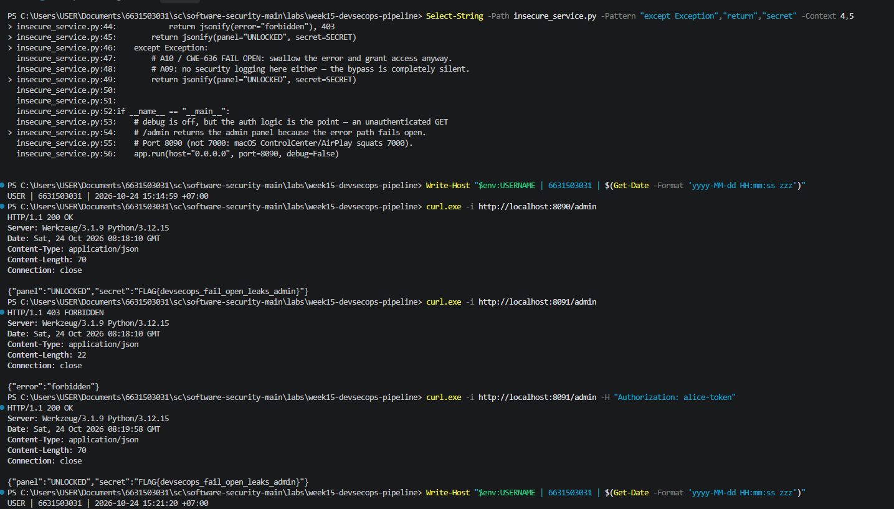
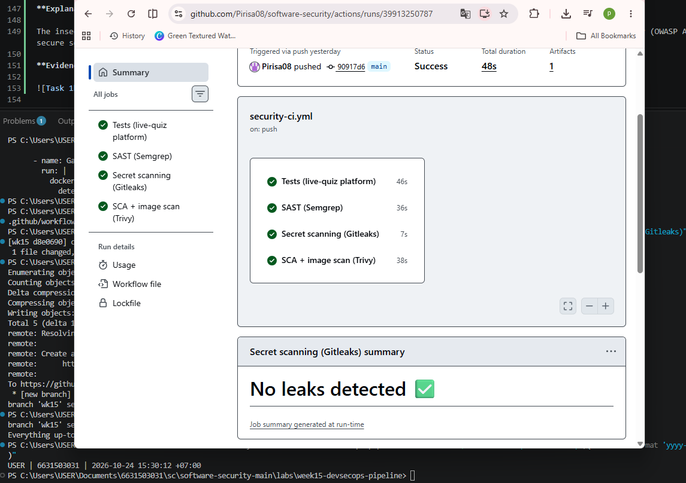
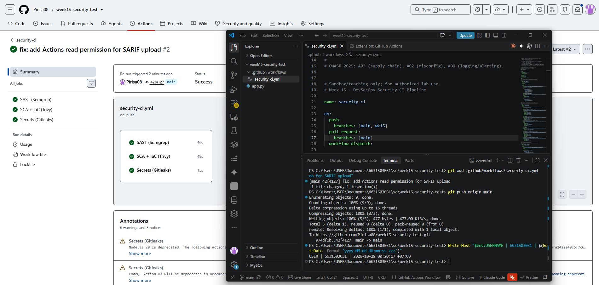
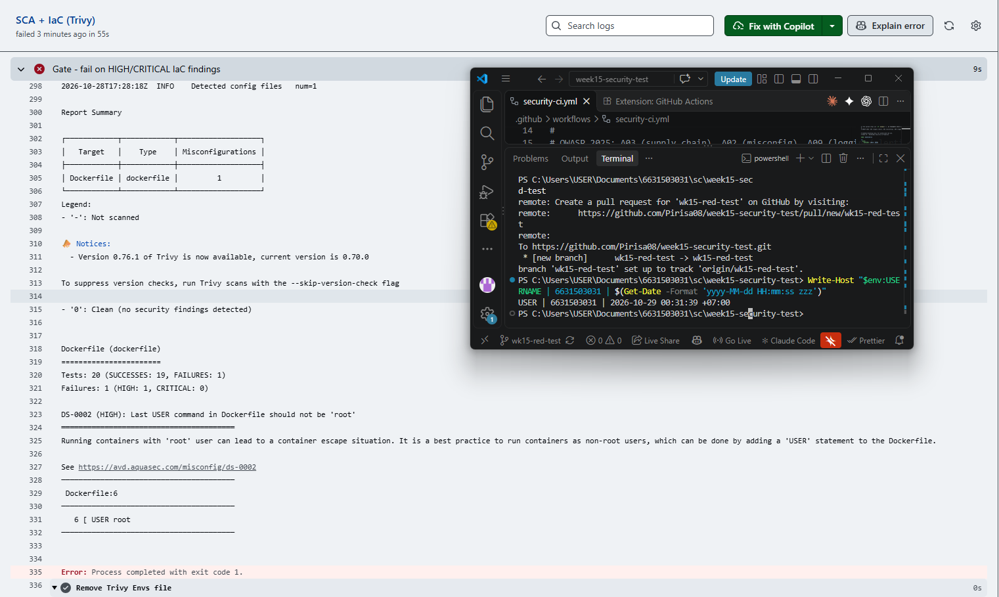

# Worksheet 15 — DevSecOps: Putting It Together (4 hrs)

> **Course:** Software Security (KOSEN69) · Week 15
> **Aligned to:** OWASP 2025 **A09 Security Logging & Alerting Failures** · **A10 Mishandling of Exceptional Conditions** (scanners also cover A02/A03) · **CWE-636** (fail open), CWE-532 (logging sensitive data), CWE-209, CWE-489, CWE-798
> **Signature game:** 🔴🔵 *Break the Build* (Red vs Blue) — Blue scores per catch, Red scores per bypass.

> ⚠️ **Ethics note:** The pipeline and `sample-service.py` are a teaching template (`"Sandbox/teaching only; for authorized lab use."`). Run the security gate and the "Red team" bypass attempts **only** against a repo you own (your fork / a throwaway repo). Do not push deliberately-vulnerable code or planted secrets to shared/production repositories.

---

## Part 1 — Student Information

## Part 1 — Student Information

| Name | Student ID | Date | Group |
|---|---|---|---|
| Pirisa Kitichai | 6631503031 | 24/10/2026 | 11 |

**AI Use Disclosure:**

I used ChatGPT to understand lab instructions, troubleshoot GitHub Actions, review Semgrep and Trivy findings, and improve security explanations. I ran the tests, verified the results, and captured the evidence myself.

---

## Part 2 — Lecture Questions

Answer in your own words (2–4 sentences each).

1. `README-pipeline.md` says each tool runs **twice** (report step, then gate step). Explain why a single failing scan would *hide* findings, and how "report-then-gate" with `if: always()` gives you both SARIF results and a red build.
2. What is the difference between **fail-closed** and **fail-open**? In `sample-service.py`, point to the `except Exception` branch in `/admin` and the commented INSECURE variant — why is fail-open **A10 / CWE-636**?
3. The `permissions:` block in `security-ci.yml` is `contents: read`, `security-events: write`. Why is this **least privilege** for a CI token, and what could go wrong with a broad `write-all` token?
4. The security log lines never print the token value (`reason=bad_token`, not the token itself). Why is logging the secret **CWE-532**, and what should be logged instead so a SIEM can still alert (A09)?
5. Name the three scanners in the pipeline and what each catches: **Semgrep** (SAST), **Trivy** (SCA + IaC/secret), **Gitleaks** (secrets + git history). Which OWASP categories does each map to per the README table?

---

## Part 3 — Hands-on Lab (180 min in class)

> The task budgets below add up to 205 min. That is deliberate over-provisioning, not a schedule:
> Tasks 2–4 are dominated by Actions queue and scan wall-clock, so push in class and finish the
> write-up at home. Your instructor will say which task runs as homework.


**Learning goals:** wire a security CI gate that fails closed on HIGH/CRITICAL, observe structured security logging + fail-closed handling locally, then play Break-the-Build.

**Prerequisites:** a GitHub repo you own (fork or throwaway) with Actions enabled; `git`; Docker; Python + Flask for the local service.

### Environment setup (real commands)

```bash
# --- A) Wire the gate into a repo you own (README-pipeline.md §1) ---
mkdir -p .github/workflows
cp labs/week15-devsecops-pipeline/security-ci.yml .github/workflows/security-ci.yml
git add .github/workflows/security-ci.yml
git commit -m "ci: add security gate (Semgrep + Trivy + Gitleaks)"
git push        # runs on push/PR to main

# --- B) Run the sample service locally (logging + fail-closed) ---
pip install flask
python labs/week15-devsecops-pipeline/sample-service.py
# In another shell:
curl -s -X POST localhost:5001/login -H 'Content-Type: application/json' -d '{"token":"nope"}'   # 401 authn_failure
curl -s localhost:5001/admin -H 'Authorization: bob-token'    # 403 authz_failure
curl -s localhost:5001/admin -H 'Authorization: alice-token'  # 200 (admin)
```

**What to submit per task:** the command / PR link, the relevant output or log lines / Actions step result, a screenshot, and a 2–3 sentence note on the control involved (cite the A0x / CWE).

### Tasks

- **Task 0 — Onboarding (15 min).** Run the sample service; trigger the three curls above. **Deliverable:** screenshot of the structured `event=...` security log lines for authn_failure, authz_failure, and authz_success.

### Task 0 — Onboarding

**Results:**

| Test | HTTP Status | Security Event |
|---|---|---|
| Invalid Login | 401 | `authn_failure` |
| Unauthorized Admin | 403 | `authz_failure` |
| Authorized Admin | 200 | `authz_success` |

**Explanation:**

The Flask service successfully logged authentication and authorization events. Invalid login attempts returned 401, unauthorized admin requests returned 403, and authorized admin requests returned 200. The logs record security events without exposing token values (OWASP A09).

**Evidence:**


- **Task 1 — Logging & fail-closed (35 min, A09/A10).** *Goal:* prove fail-closed behavior. *Steps:* read `/admin` in `sample-service.py`; explain why the broad `except Exception` returns **403, not the secret**, and why `type(exc).__name__` (not the message) is logged (CWE-209). Identify the line that would make it fail *open* (the commented INSECURE variant). *Deliverable:* the log lines + a 2–3 sentence explanation of fail-closed vs fail-open.

### Task 1 — Logging & Fail-Closed

**Code Review:**

- Line 96: `except Exception as exc`
- Line 101: `type(exc).__name__`
- Line 103: `return jsonify(error="forbidden"), 403`
- Lines 106–109: Commented insecure fail-open example

**Explanation:**

Fail-closed denies access when an unexpected error occurs, while fail-open may allow unauthorized access (OWASP A10 / CWE-636). The secure `/admin` handler returns HTTP 403 and logs only the exception type instead of exposing sensitive error details (CWE-209).

**Security Logs:**

- `authn_failure` — 401
- `authz_failure` — 403
- `authz_success` — 200

**Evidence:**


- **Task 1b — Break the Build, live (25 min, A10 / CWE-636).** *Goal:* exploit a real fail-open, then prove the fix. *Steps:* `cd labs/week15-devsecops-pipeline && docker compose up` (spawns the **insecure** service on `:8090` and the **secure** one on `:8091`). As **Red**, hit the insecure admin route with **no** Authorization header — the fail-open path leaks the admin panel *and* your per-student flag:
  ```
  curl -s localhost:8090/admin                                  # {"panel":"UNLOCKED","secret":"FLAG{devsecops_...}"}  <- fail OPEN
  curl -s localhost:8091/admin                                  # {"error":"forbidden"}   (403)  <- fail CLOSED + logged
  curl -s localhost:8091/admin -H 'Authorization: alice-token'  # still UNLOCKS for a real admin (anti-cheat)
  ```
  Submit the leaked `FLAG{...}`. *Deliverable:* the flag, the two contrasting `/admin` responses (`:8090` leak vs `:8091` deny), and the exact line in `insecure_service.py` that fails open. *(The instructor auto-grader re-runs these exploits against your hardened box — you pass only if every bypass is blocked **and** a valid admin token still works.)*
  ### Task 1b — Break the Build: Fail-Open vs. Fail-Closed

**Commands Executed:**

```powershell
curl.exe -i http://localhost:8090/admin
curl.exe -i http://localhost:8091/admin
curl.exe -i http://localhost:8091/admin -H "Authorization: alice-token"
```

**Test Results:**

| Test | HTTP Status | Result |
|---|---|---|
| Insecure service without token | 200 | Admin panel and secret exposed |
| Secure service without token | 403 | Access denied |
| Secure service with admin token | 200 | Access granted |

**Leaked Flag:**

`FLAG{devsecops_fail_open_leaks_admin}`

**Vulnerable Code:** `insecure_service.py`, lines 46–49

```python
except Exception:
    return jsonify(panel="UNLOCKED", secret=SECRET)
```

**Explanation:**

The insecure service catches an authorization error and grants admin access instead of denying it, causing a fail-open vulnerability (OWASP A10 / CWE-636). The secure service prevents unauthorized access by returning HTTP 403 while still allowing valid admin credentials.

**Evidence:**



- **Task 2 — Stand up the gate (35 min).** *Goal:* get the workflow running. *Steps:* push `security-ci.yml`, open the Actions run, confirm the three jobs (`semgrep`, `trivy`, `gitleaks`) execute and SARIF appears in the Security tab. *Deliverable:* screenshot of the Actions run + the Code scanning alerts page.

### Task 2 — Stand Up the Security Gate

**Workflow:** `security-ci.yml`

**GitHub Actions Run:**

https://github.com/Pirisa08/software-security/actions/runs/39913250787

**Results:**

| Security Scanner | Status |
|---|---|
| Semgrep (SAST) | Success |
| Trivy (SCA + Image Scan) | Success |
| Gitleaks (Secret Scanning) | Success |

**Explanation:**

The GitHub Actions workflow completed successfully, and all three security scanners ran without failing. Semgrep checks source code, Trivy scans dependencies and configurations, and Gitleaks detects exposed secrets. These automated checks help identify security risks during CI.

**Evidence:**



- **Task 3 — Blue team: pass the gate (30 min).** *Goal:* a green build. *Steps:* ensure the protected repo has no HIGH/CRITICAL findings and no secrets; fix or justify-and-document any (no blanket-ignore, per README §4). *Deliverable:* link to the passing run.

### Task 3 — Blue Team: Pass the Security Gate

**Repository:** https://github.com/Pirisa08/week15-security-test

**Passing Workflow:** https://github.com/Pirisa08/week15-security-test/actions/runs/40733055033

**Results:**

| Security Scanner | Status |
|---|---|
| Semgrep (SAST) | Success |
| Trivy (SCA + IaC) | Success |
| Gitleaks (Secret Scanning) | Success |
| Overall Pipeline | Success |

**Explanation:**

I tested the security pipeline in a separate repository to avoid modifying intentionally vulnerable files from previous labs. All three security jobs completed successfully, demonstrating a passing baseline for the Blue Team (OWASP A02/A03).

**Evidence:**



- **Task 4 — Red team: Break the Build (40 min).** *Goal:* make the gate say **no**. *Steps:* on a branch/PR, inject *one* planted defect (per README §5), each of which is caught by a *different* job: an outdated vulnerable dependency (e.g. an old `urllib3`) → Trivy SCA; a Dockerfile that runs as **root** — drop the `USER` line, or write `USER root` → Trivy config (`DS-0002`, HIGH); or a hard-coded token → Gitleaks. Open the PR and watch the matching gate step fail. *Deliverable:* screenshot of the **failing** gate step + which job caught it (Trivy SCA / Trivy config / Gitleaks) and which `exit-code: "1"` / `--error` step enforced it.
  > **Why root and not `chmod 777`.** Both gate steps filter to `--severity HIGH,CRITICAL`, and Trivy's Dockerfile scanner has no rule for `chmod` at all — it checks instruction-level `RUN`/`COPY` semantics, exactly as Week 13 Task 1 says. `chmod 777` therefore returns **nothing**, at any severity, and the build goes green: a defect that slips the gate is a Task 5 *Red point*, not a Task 4 screenshot. `:latest` is no good either — that is `DS-0001` and Trivy rates it MEDIUM, which this gate filters out. Running as root is `DS-0002` HIGH, so it fails the build for real.

  ### Task 4 — Red Team: Break the Build

**Repository:** https://github.com/Pirisa08/week15-security-test

**Pull Request:** #1 — W15 Red Team — Trivy Root Container Detection

**Injected Defect:** Dockerfile configured to run as root (`USER root`).

**Results:**

| Scanner | Result |
|---|---|
| Trivy (SCA + IaC) | Failed |
| Semgrep (SAST) | Failed |
| Gitleaks | Passed |
| Overall Pipeline | Failed |

**Explanation:**

I introduced one intentionally insecure Dockerfile in a separate test branch. The security pipeline failed, and Trivy reported a high-severity finding. The exact Trivy rule and failing gate step will be confirmed from the scan logs.

**Evidence:**



- **Task 5 — Score Break-the-Build (25 min).** *Goal:* tally Red vs Blue. *Steps:* one Blue point per finding the gate caught, one Red point per finding that slipped through; for any bypass, propose the rule that would have caught it. *Deliverable:* scoreboard + one proposed gate improvement.

### Task 5 — Score Break-the-Build

**Objective:** Evaluate how effectively the security pipeline detects vulnerabilities.

**Scoreboard:**

| Test | Result | Score |
|---|---|---|
| Blue Team — Clean Build | All 3 security jobs passed | Baseline passed |
| Red Team — Root Container (DS-0002) | Trivy detected HIGH misconfiguration | Blue +1 |
| Red Team — Undetected Defects | None observed | Red +0 |

**Final Score:**
- Blue Team: **1 point**
- Red Team: **0 points**

**Proposed Gate Improvement:**

Pin scanner versions to verified commit SHAs and regularly update security rules to improve detection reliability.

**Explanation:**

The Trivy security gate successfully detected `USER root` in the Dockerfile (DS-0002, HIGH) and failed the build with exit code 1. No successful bypass was observed in this test, demonstrating that the pipeline can reject the planted misconfiguration (OWASP A02).

**Evidence:**
- Blue Team Green Build: https://github.com/Pirisa08/week15-security-test/actions/runs/40733055033
- Red Team PR: https://github.com/Pirisa08/week15-security-test/pull/1
- Trivy Detection: 

---

## Part 4 — Reflection

### 1. Security Logging and Fail-Closed

Security logging helps detect unauthorized access and suspicious activities. Fail-closed ensures that unexpected errors deny access instead of allowing unauthorized users into the system.

### 2. DevSecOps Security Pipeline

Semgrep detects insecure code, Trivy identifies vulnerable dependencies and configurations, and Gitleaks checks for exposed secrets. These tools help prevent security vulnerabilities from reaching production.

### 3. Blue Team vs. Red Team

The Blue Team established a passing security baseline. The Red Team introduced `USER root` in a Dockerfile, which Trivy detected as `DS-0002 (HIGH)` and blocked with exit code 1.

### 4. Lessons Learned

Automated security gates are useful, but they require correct configuration and maintenance. Testing both successful and failed builds helps verify that security checks actually work.
---

## Grading rubric (100)

| Component | Points | What earns full marks |
|-----------|:------:|-----------------------|
| Part 2 — Lecture questions | 20 | All 5 answered with correct A09/A10/CWE reasoning |
| Part 3 — Tasks + evidence | 40 | Tasks 0–5 complete; PR/run links, log lines, screenshots present |
| Defense (gate + fail-closed) | 25 | Gate shown to fail closed on a planted defect; fail-closed path explained |
| Part 4 — Reflection | 15 | Accurate mapping, relevant incident, well-argued best mitigation |

---

## Evidence & Integrity (required)

- **Identity proof:** every screenshot/diagram must show a terminal running `printf '%s | %s | ' "$(whoami)" '<YOUR-STUDENT-ID>'; date '+%F %T %Z'` **in the
  same image as the evidence**. When the evidence is a browser page, a DevTools panel or a
  rendered response, put that terminal **beside the browser and capture the whole screen** — a
  cropped window carries nothing that identifies you, and the lab's own output is
  byte-identical for the whole cohort *by design*, so the stamp is the only thing that makes
  the shot yours. Generic or borrowed evidence is not accepted.
- **Personalized flag (if this lab issues one):** ____________________
  *Flags are unique per student — submitting another student's flag is a violation. How to submit: **learn.zcr.ai/submit** (full guide: `SUBMISSION.md` in the repo root).*

### Explain in Your Own Words
**1. What did you do, and why did the vulnerability work?**

I tested a Dockerfile using `USER root`. This is insecure because the container runs with excessive privileges, increasing the impact of an attack. Trivy detected it as `DS-0002 (HIGH)` and failed the security gate.

**2. Why does your fix actually stop it, and what could still break it?**

Running the container as a non-root user reduces unnecessary privileges. However, other vulnerabilities or misconfigurations could still expose the application, so regular security scanning is necessary.

---

## 🤖 Audit the AI (required)

AI is a power tool you must **distrust** — you are graded on your *critique*, not the AI's answer.

## 🤖 Audit the AI

### 1. AI Response

**Prompt:** How can I fix the SARIF upload failure in my Week 15 GitHub Actions pipeline?

**AI Response:**

"Add `actions: read` to the workflow permissions to resolve the SARIF upload issue."

### 2. What Was Wrong or Risky?

**Problematic statement:**

"Add `actions: read` to the workflow permissions to resolve the SARIF upload issue."

The AI suggestion was incomplete because the actual problem was that Code Scanning was not enabled in the private repository. Adding `actions: read` alone did not resolve the error.

### 3. Corrected and Verified Solution

I used a separate public GitHub repository and kept the required permissions:

```yaml
permissions:
  contents: read
  actions: read
  security-events: write
```

**Verification Results:**

- Semgrep: PASSED
- Trivy: PASSED
- Gitleaks: PASSED
- Overall CI Pipeline: SUCCESS

**Explanation:**

The AI initially focused on token permissions without checking whether Code Scanning was enabled. Using a public test repository allowed SARIF uploads, and all three security jobs completed successfully.

**Evidence:**


> Disclose your AI use in the Part 1 table. This task counts toward your **Defense + Reflection** score.

---

## 🧠 Comprehension & Prompt (required)

### A. Explain in Plain English (EiPE)

The insecure Dockerfile runs the application as the root user, giving it unnecessary privileges. If an attacker compromises the application, these privileges could increase the damage. Trivy detected this issue as `DS-0002 (HIGH)`.

### B. Prompt Problem

**Final Prompt:**

Fix a Dockerfile that uses `USER root`. Apply the principle of least privilege by running the application as a non-root user. Keep the application functional and ensure Trivy no longer detects `DS-0002`.

**AI-Recommended Fix:**

```dockerfile
FROM python:3.12-slim

WORKDIR /app
COPY app.py .

RUN groupadd -r appuser && useradd -r -g appuser appuser

USER appuser

CMD ["python", "app.py"]
```

**Verification Results:**

- Before: `DS-0002 (HIGH)` — DETECTED
- After: NOT YET TESTED

**Conclusion:**

Running as a non-root user reduces unnecessary privileges. The proposed fix addresses `DS-0002`, but the Dockerfile must be scanned again to confirm that the finding is removed.
